> **一句话摘要**：埃斯顿机器人逐台出厂的实际 D-H 参数都不一样，直接用它做手眼标定，精度一定对不上。本文记录从接线、配 IP、VNC 进控制器后台读 `RobotParam`，到改 Mech-Viz 模型 `algo.json` 的完整操作，附密码、路径、踩坑清单和原文勘误。

---

## 先看结论

整件事只有三步：

| 步骤 | 做什么 | 在哪做 |
|---|---|---|
| ① 读 | 从机器人控制器里读出**这台机器实际**的 D-H 参数 | 网线直连控制器 LAN4 → VNC 进后台 → 看 `RobotParam` |
| ② 抄 | 把 L1~L7 七个连杆值抄下来 | 记事本 |
| ③ 改 | 把这七个值填进 Mech-Viz 的机器人模型 | Mech-Viz → 右键模型 → 打开资源文件 → `[robot]_algo.json` |

难点全在 ①，因为要进控制器后台。②③ 是纯抄写操作。

---

## 为什么埃斯顿必须一台一台改

这不是配置疏忽，是埃斯顿的设计特点。

**控制器里存的是「这台」的真实值，Mech-Viz 里用的是「这个型号」的标准模型。**

机器人本体在加工和装配时存在公差，每台六轴的连杆实际长度、关节零位都有微小差异。埃斯顿在出厂时会对每台机器单独做运动学标定，把结果写进控制器的配置文件 `RobotParam`。所以同一型号的 10 台机器人，`RobotParam` 里的数值是 10 组不同的数。

而 Mech-Viz 的机器人模型库里放的是**该型号的标准模型**——一套理论值。

这就产生了一个隐形误差源。官方文档对后果写得很直接：

> 当机器人与视觉系统之间通过关节角发送位姿数据时，如果真实机器人 DH 参数与仿真用的机器人 DH 参数不一致，会引入机器人精度误差。

三个典型会踩到的场景：

1. 部分机器人的手眼标定（走主控通信）
2. 只接收机器人关节角、不接收位姿的 EIH 场景
3. 向机器人发送路径点关节角的场景

这三种情况下，Mech-Viz 要**用 DH 参数自己算出位姿**。模型里的连杆长度错 1 mm，算出来的位姿就偏 1 mm，标定再准也没用——误差在源头。

所以流程是：**现场每台 ESTUN 都要单独核对一遍 D-H，不能拿一台的参数套全部。**

---

## 准备清单

| 项目 | 要求 | 备注 |
|---|---|---|
| 网线 | 1 根 | 直连，不需要交换机 |
| VNC 客户端 | TightVNC（用 `tvnviewer.exe`） | 控制器自带服务端，只需装查看器 |
| 笔记本/工控机 | Windows | 与视觉工控机同一台最方便 |
| Mech-Viz | 已装，且已导入该型号机器人模型 | 否则没有 `algo.json` 可改 |
| 机器人状态 | 上电、可进入示教器界面 | 改参数不用使能 |

**两个密码（控制器默认值，现场可能被改过）：**

- VNC 远程连接密码：`[[secret:vnc-pwd|ERC654321]]`
- 控制器后台登录：用户名 `[[secret:ctl-user|estun]]` / 密码 `[[secret:ctl-pwd|estun]]`

> ⚠️ 上面两个是出厂默认。如果现场改过，找集成商或埃斯顿售后要。改密码是常规安全操作，不要硬猜。

---

## 第一步：接线

用网线把**视觉工控机**接到**机器人控制器的 LAN4 网口**。

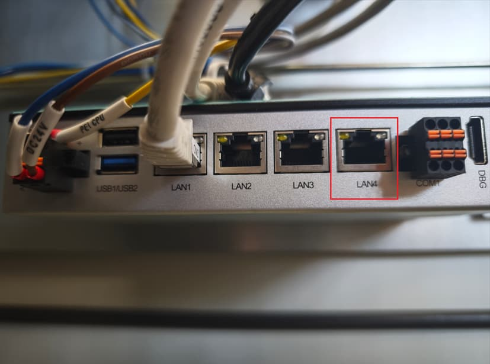

认准标着 `LAN4` 的那个口。旁边 `LAN1/2/3` 是别的用途，`DBG` 是调试口，都别插。

埃斯顿控制器对网口的功能划分是这样的：

| 网口 | 用途 |
|---|---|
| ETH1（LAN3） | TCP/IP、ModbusTCP |
| **ETH2（LAN4）** | **VNC、EtherNet/IP、PROFINET** |

VNC 服务挂在 LAN4 上，所以必须插这个口。

---

## 第二步：查控制器 LAN4 的 IP

在示教器上依次操作：

**主界面左上角主页图标 → 高级设置 → 网络设置 → 网口显示切到 `ETH2(1an4)`**

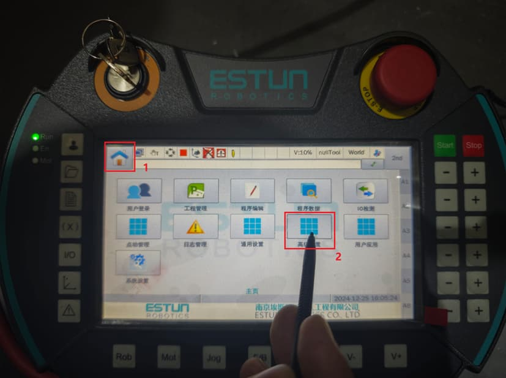

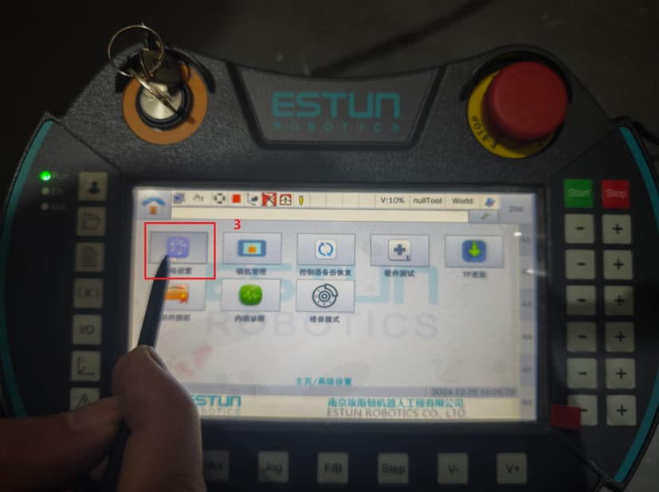

切到 `ETH2(1an4)` 之后，看到这一组值：

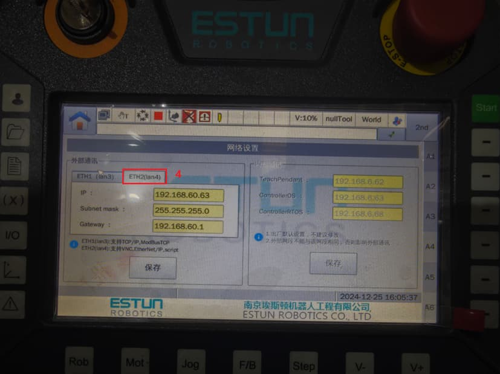

```
IP          : 192.168.60.63
Subnet mask : 255.255.255.0
Gateway     : 192.168.60.1
```

界面下方还有一行厂家的备注，值得记一下：

> 1. 出厂默认设置，不建议修改。
> 2. 外部网口不能与调试网段相同，否则影响外部通讯。

**记下这个 IP**，下一步要用。

> 📌 **勘误**：不少流传的教程（包括原始社区帖）把这里写成 `196.168.60.63`，是笔误。实际是 **192**.168.60.63，示教器截图上写得很清楚。照 196 段配 IP 是连不上的。

---

## 第三步：给工控机配同网段 IP

打开工控机的网络适配器（就是刚插网线那个口），改成和 LAN4 同一网段：

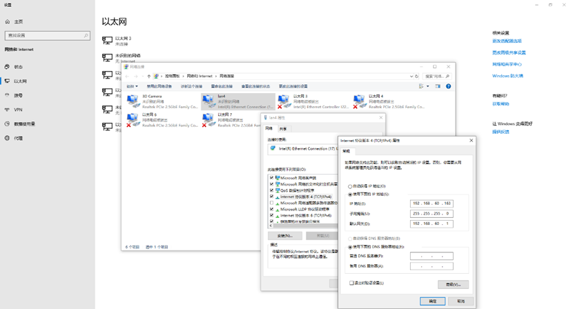

```
IP          : 192.168.60.161   ← 同网段，别和 .63 撞
Subnet mask : 255.255.255.0
Gateway     : 192.168.60.1     ← 与控制器一致
```

配完**先 ping 一下**，通了再往下：

```powershell
ping 192.168.60.63
```

看到 `来自 192.168.60.63 的回复: 字节=32 时间<1ms TTL=64` 才算成功。

ping 不通就去查：网线是不是插错口、防火墙是不是拦了、两边是不是真在同一网段。**这一步不通，后面全白搭**，别急着开 VNC。

---

## 第四步：VNC 连进控制器后台

### 启动 VNC 查看器

解压 VNC 安装包，运行 `tvnviewer.exe`（不是 `tvnserver.exe`，那是服务端）：

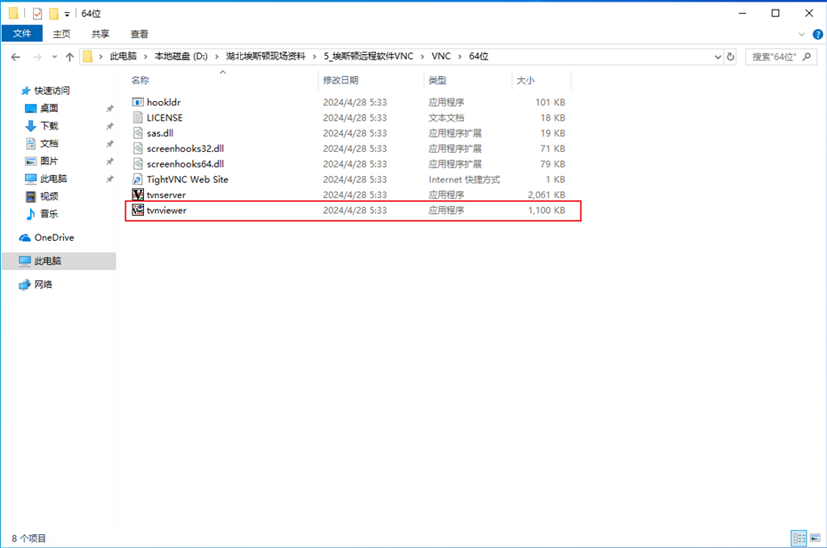

### 填 IP 连接

远程主机填刚才记下的 `192.168.60.63`，点「连接」：

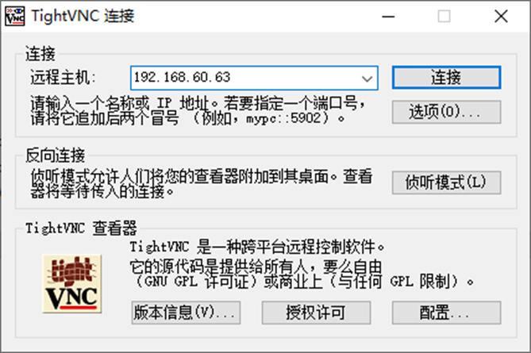

### 输入远程密码

密码：`[[secret:vnc-pwd|ERC654321]]`

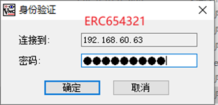

### 进入控制器后台

连上后会看到 `ESTUN TOOL SERVER` 界面，右侧竖排四个按钮：**主界 / 管理 / 最小化 / 关闭**。

点 **「管理」**：

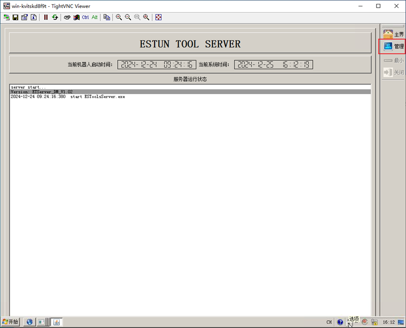

会弹登录框，用户名和密码都填 `[[secret:ctl-user|estun]]`：

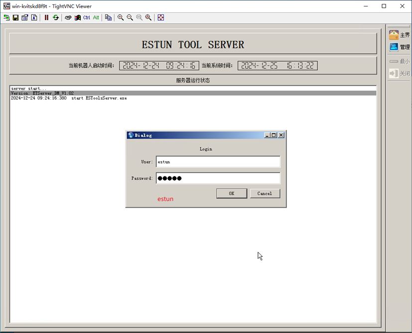

### 最小化，露出 Windows 桌面

登录后点 **「最小化」**，把 TOOL SERVER 窗口缩下去，露出控制器的 Windows 桌面：

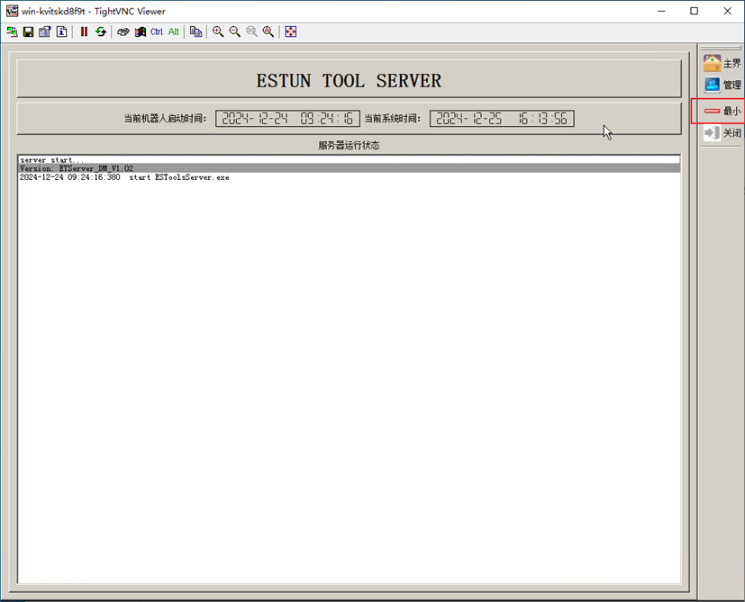

> ⚠️ **这里是最容易出事的一步。**
>
> 控制器屏幕上跑着一个常驻的运行窗口，那是机器人实时任务。**千万不要点它的关闭按钮。** 原始教程在这里连用了 8 个感叹号强调——关掉轻则通讯中断要重启控制器，重则影响正在运行的生产任务。
>
> 只点「最小化」，别去碰桌面上其它窗口的 ✕。

---

## 第五步：进控制器桌面找文件

在控制器桌面上双击「我的电脑 / 计算机」，进文件管理器：

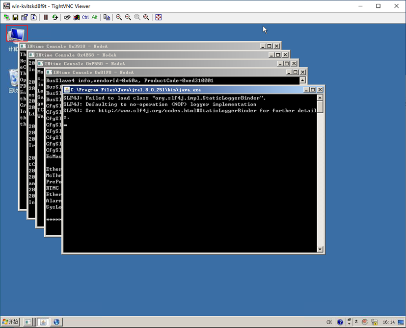

导航到：

```
C:\runtime\config\
```

这个目录里是一堆机器人配置文件：

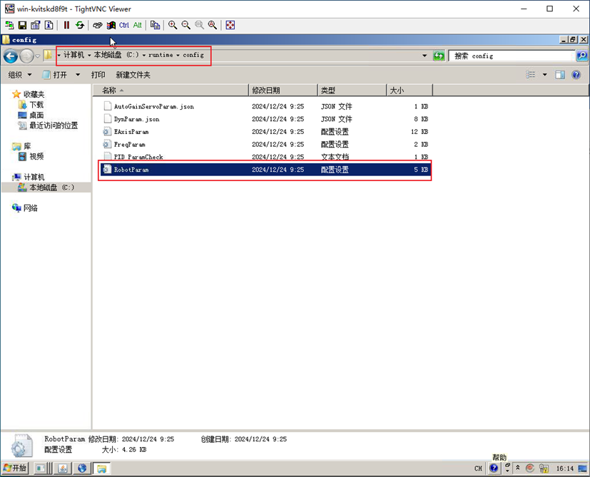

| 文件 | 大小 | 内容 |
|---|---|---|
| `AxisParam` | 12 KB | 轴参数 |
| `DynParam.json` | 8 KB | 动力学参数 |
| **`RobotParam`** | **5 KB** | **← 连杆/D-H 参数在这个里面** |
| `AutoGainServoParam.json` | 1 KB | 伺服增益 |
| `FreqParam` | — | 频率参数 |
| `PID_ParamCheck` | 1 KB | PID 校验 |

**`RobotParam` 没有扩展名**，双击大概率不会自动打开。右键 → 打开方式 → 记事本。

---

## 第六步：读出实际 D-H 参数

用记事本打开后，开头 `[Mach]` 段就是机器人连杆参数：

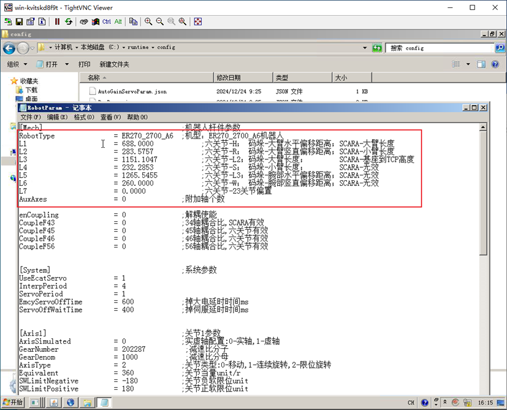

```ini
[Mach]                    ;机器人杆件参数
RobotType  = ER270_2700_A6   ;机型：ER270_2700_A6机器人
L1         = 688.0000
L2         = 283.5757
L3         = 1151.1047
L4         = 232.2853
L5         = 1265.5455
L6         = 260.0000
L7         = 0.0000
AuxAxes    = 0            ;附加轴个数
```

**把这 8 行（`L1` 到 `L7`，加 `RobotType`）原样抄下来。**

> 🔎 **一个重要提醒**：右侧注释栏里写的「SCARA-大臂长度」「码垛-腕部水平偏移距离」之类，是埃斯顿配置文件里的**通用注释模板**，SCARA、码垛、六轴共用一个文件格式。对 ER270 这种六轴机型，这些字面意思**不完全对应**，别按注释去理解 L2 到底代表什么。
>
> 你需要做的只是：**原样抄数字，原样填到 Mech-Viz**。中间不需要知道每个 L 对应哪根连杆。

上面的数值只是示例（一台 ER270-2700），**你的机器一定是别的数**。照抄示例 = 精度直接崩。

---

## 第七步：改 Mech-Viz 的机器人模型

### 找到模型对应的资源文件

打开 Mech-Viz，在场景里选中现场对应的机器人模型（这里是 `ESTUN_ER270_2700`），**右键 → 打开资源文件**：

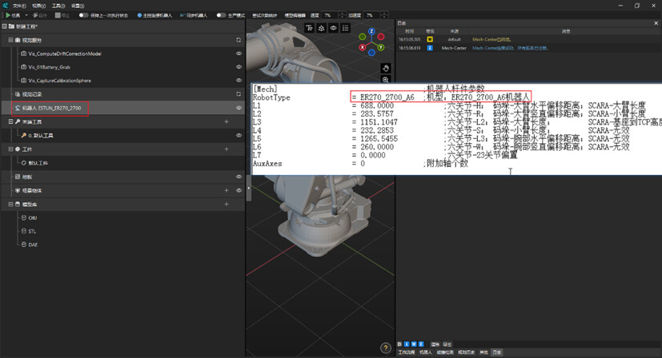

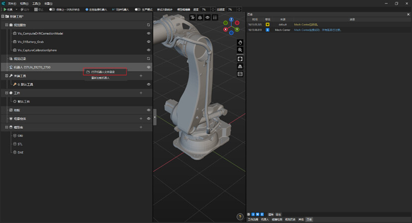

资源目录会打开，一般在这个路径：

```
C:\Users\<用户名>\AppData\Roaming\Mmind\robot\estun\estun_er270_2700\
```

里面有 4 个文件：

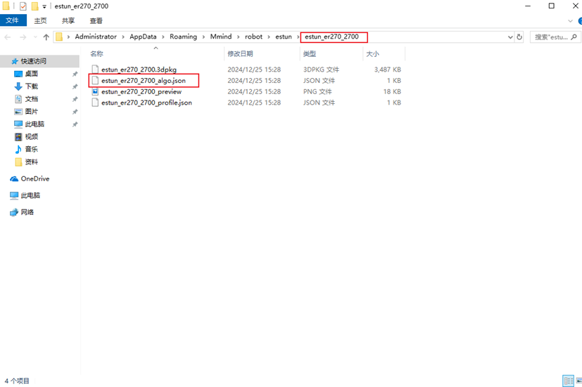

| 文件 | 作用 |
|---|---|
| `estun_er270_2700_3dpkg` | 3D 模型包，别动 |
| **`estun_er270_2700_algo.json`** | **← 连杆参数在这里，要改的就是它** |
| `estun_er270_2700_preview.png` | 缩略图 |
| `estun_er270_2700_profile.json` | 机型属性 |

> 📌 **勘误**：原始社区帖写的是「选择对应的【aglo】文件」，`aglo` 是 `algo` 的笔误。实际扩展名是 `.json`，文件名以 `_algo.json` 结尾。

### 对比两边的值

用记事本打开 `estun_er270_2700_algo.json`，它的连杆参数不在 `L1`~`L7` 这种字段里，而是一个叫 **`ph`** 的数组：

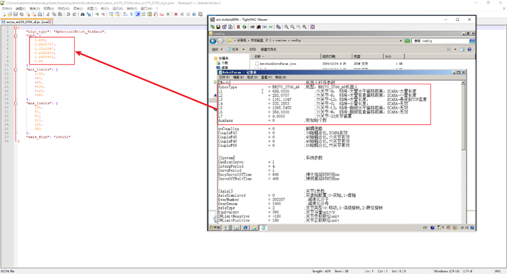

```json
{
    "algo_type": "SphericalWrist_SixAxis",
    "ph": [
        0.688,
        0.2835757,
        1.1511047,
        0.2322853,
        1.2655455,
        0.26
    ],
    "min_limits": [ -180, -60, -95, -200, -125, -360 ],
    "max_limits": [  180,  80,  80,  200,  125,  360 ],
    "axis_flip": "100101"
}
```

对照上面从 `RobotParam` 抄下来的值，能看出一条很关键的换算关系：

| RobotParam（mm） | `ph` 数组（m） |
|---|---|
| `L1 = 688.0000` | `0.688` |
| `L2 = 283.5757` | `0.2835757` |
| `L3 = 1151.1047` | `1.1511047` |
| `L4 = 232.2853` | `0.2322853` |
| `L5 = 1265.5455` | `1.2655455` |
| `L6 = 260.0000` | `0.26` |
| `L7 = 0.0000` | **不在数组里** |

两条必须记住：

> 🔴 **单位不同**：`RobotParam` 是**毫米**，`algo.json` 的 `ph` 数组是**米**。直接把 `688` 填进数组会让机器人变成 688 米长的怪物，Mech-Viz 当场崩或模型飞到天边。**一律除以 1000**。
>
> 🔴 **只填 6 个，不是 7 个**：`ph` 数组固定 6 个元素，对应 L1~L6。`RobotParam` 里的 `L7`（附加轴偏移，通常为 0）不进这个数组，别硬塞第 7 个值——数组变成 7 个元素会导致解析失败。

`algo_type`、`min_limits`、`max_limits`、`axis_flip` 这些**不要动**。它们是机型运动学类型和关节限位，跟这台机器的加工公差无关，改了会让模型行为异常。

判断标准：

- `ph` 六个值和 `RobotParam` 的 L1~L6 ÷ 1000 完全一致 → 这台机器不用改
- 有任何一位不同 → 逐个替换成实机值（保留原有小数位精度，别四舍五入）

### 保存并重启

1. 保存 `algo.json`（UTF-8，别用 Word 打开）
2. **关闭 Mech-Viz 和 Mech-Vision**
3. 重新启动视觉软件

模型参数是启动时加载并缓存的，不重启不生效。

> 💡 动手前先**备份原文件**：把 `estun_er270_2700_algo.json` 复制一份改名成 `estun_er270_2700_algo.json.bak` 放在同目录。改错了直接换回来，比重装模型快得多。
>
> 另外：升级 Mech-Viz 或重新导入机器人模型时，`AppData` 下这个目录可能被覆盖。**升级后要重新核对一遍 `ph` 数组**。

---

## 第八步：验证

改完之后怎么确认真的生效了？三个层次的验证：

**① 看数值**：重新打开 `algo.json`，确认 `ph` 六个值还在（有的编辑器崩溃会丢改动）。

**② 看软件**：重启 Mech-Viz，选中机器人模型，看模型属性里的连杆参数是否变成了新值。

**③ 看精度**：这是真正的验收。做完手眼标定后走一遍标准验证流程，看绝对精度是否在允许范围内。如果改前改后精度没区别，说明：

- 要么改动根本没生效（回 ①② 查）
- 要么这台机器的 `RobotParam` 本来就等于标准模型（少见，但存在）

---

## 踩坑清单

| 坑 | 现象 | 处理 |
|---|---|---|
| 网线插错口 | VNC 连不上 | 必须插 **LAN4**，不是 LAN1/2/3 |
| IP 按 196 段配 | ping 不通 | 实际是 **192**.168.60.63 |
| 工控机 IP 和控制器撞 | 时通时不通 | 工控机用 .161 之类的其他地址 |
| 防火墙拦 VNC | 连接超时 | 关掉工控机防火墙对应网段的拦截 |
| **关掉控制器运行窗口** | 通讯中断 / 需重启控制器 | 只点「最小化」，绝对不点 ✕ |
| 照抄教程里的 L1~L7 | 精度反而变差 | 每台不同，必须读自己这台 |
| **mm 直接填进 `ph` 数组** | 模型巨大 / Mech-Viz 崩溃 | `ph` 单位是**米**，一律 ÷1000 |
| **往 `ph` 里塞第 7 个值** | json 解析失败、模型加载不出来 | `ph` 固定 6 个，`L7` 不进数组 |
| 改了 `min/max_limits` | 关节限位异常、规划报错 | 只改 `ph`，其它字段不要动 |
| 用 Word 编辑 json | 文件损坏、Mech-Viz 起不来 | 用记事本 / VS Code，UTF-8 |
| 改完没重启软件 | 参数不生效 | 关掉 Mech-Vision + Mech-Viz 再开 |
| 升级 Mech-Viz 后没复查 | 参数被重置回标准模型 | 升级/重导模型后重新核对 `ph` |
| 找错模型目录 | 改了没反应 | 右键的是**场景里正在用的那个模型** |

---

## 常见问题

**Q：每台都要改吗？一个车间 20 台怎么办？**

每台都要核对。但可以批量做：把 20 台的 `RobotParam` 都读出来存成文本，逐台比对一次。如果某一批是同批次出厂的，值可能相同，那就一次改完覆盖。**但一定要核对过再下结论**——「应该一样吧」是这类项目最常见的翻车起点。

**Q：`RobotParam` 能不能直接改？**

不建议。这是控制器运动学模型，改错了机器人会动到不该去的地方，有安全风险。这里**只读**。要改的是 Mech-Viz 那边。

**Q：`base_offset` 要不要改？**

`algo.json` 里如果还有 `base_offset` 之类的字段，一般不用动。它描述机器人基座相对世界坐标的偏移，和连杆 D-H 是两回事。除非机器人装在倾斜底座或移动平台上，否则保持原值。

**Q：VNC 密码被改过怎么办？**

找集成商或埃斯顿售后。硬猜没意义，而且频繁试错可能触发锁定。

**Q：能不能不进控制器就读到 D-H？**

部分机型可以在示教器的「系统信息 / 机器人参数」界面直接看。但 `RobotParam` 是权威来源，数值最全——示教器上显示的可能只是其中一部分。有条件还是读文件。

---

## 原文勘误（如果你也在照社区帖做）

网上流传的这份操作指南（梅卡曼德在线社区，ESTUN 机器人查看 DH 参数）内容是对的，但有几处笔误值得提前知道，省得现场卡住：

| 原文 | 实际 | 影响 |
|---|---|---|
| 默认 IP `196.168.60.63` | `192.168.60.63` | 按 196 配 IP 直接连不上 |
| 「选择对应的【aglo】文件」 | `[robot]_algo.json` | 找不到 aglo 这个后缀 |
| 「找到对应的 RobotParam」 | `C:\runtime\config\RobotParam`，无扩展名 | 双击不打开，会以为文件坏了 |
| **只说「修改对应的 D-H 参数」** | **`ph` 是米制、6 个值、对应 L1~L6** | **照 L1~L7 逐字段填会改错，单位错了直接崩** |
| 未说明控制器运行窗口的风险 | 关掉会中断机器人运行 | 原文用了 8 个感叹号强调，别当玩笑 |

第 4 条是这份原教程最大的坑：它只写「修改机器人模型配置文件中对应的 D-H 参数和当前机器人实际 D-H 参数一致」，但控制器里叫 `L1~L7` 毫米值，模型里叫 `ph` 数组米制 6 值。中间这层换算完全没写，只能靠截图对照发现。

---

## 附：参考

- 梅卡曼德官方文档：[机器人 DH 参数检查](https://docs.mech-mind.net/zh/suite-software-manual/latest/vision-tools/accuracy-error-analysis-tool-robot-dh-parameters-checking.html)（DH 参数定义、使用场景、检查三步法）
- 梅卡曼德官方文档：[机器人模型参数校验教程](https://docs.mech-mind.net/zh/suite-software-manual/latest/appendix/robot-parameters-verification.html)
- 梅卡曼德官方文档：[机器人模型库](https://docs.mech-mind.net/zh/suite-software-manual/latest/viz-tools/robot-library.html)
- 梅卡曼德在线社区：[操作指南-ESTUN机器人查看DH参数](https://community.mech-mind.com.cn/t/topic/3665)（本文原始操作流程来源）

---

*本文操作流程整理自梅卡曼德在线社区公开教程，结合现场实践补充了勘误、验证方法和踩坑清单。文中截图来自原教程，版权归原作者及梅卡曼德所有。*
