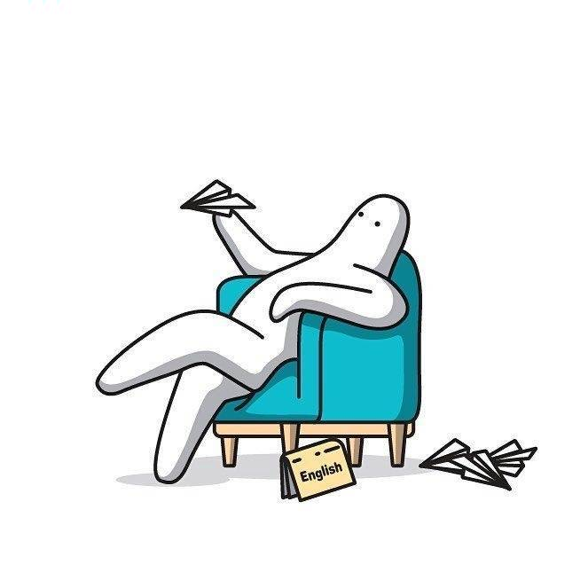

<!-- 页面内容 -->

  <!-- 标题区 -->
  

    <h1>给我留言</h1>
    
你的每句话，都是这里的星光 ✨

    
成为友邻的第一步 · <a href="/link/" style="color: var(--accent, oklch(0.65 0.18 260)); text-decoration: none; font-weight: 500;">先看看友链墙 →</a>

  

  <!-- 我的博客信息 -->
  

    
我的博客信息

    

      
      

        
G/ren的小破站

        
机器视觉调试工程师 | 技术分享

        

          <a href="https://www.hehehey.top/" style="color: var(--accent, oklch(0.65 0.18 260)); text-decoration: none;">https://www.hehehey.top/</a>
        

      

      <button onclick="copySiteInfo()" id="copyBtn" style="background: var(--card-bg); border: 1px solid var(--border); border-radius: 50px; padding: 8px 18px; font-size: 0.82rem; cursor: pointer; transition: all 200ms ease; font-family: inherit; color: var(--text-high);">复制站名和链接</button>
      <button onclick="copySiteHTML()" id="copyHTMLBtn" style="background: var(--card-bg); border: 1px solid var(--border); border-radius: 50px; padding: 8px 18px; font-size: 0.82rem; cursor: pointer; transition: all 200ms ease; font-family: inherit; color: var(--text-high);">复制 HTML 链接</button>
    

  

  

  <!-- 联系卡片 -->
  

    

      

        
📧

        
邮箱

        
mr.he2002@foxmail.com

      

      

        
⏱️

        
回复时间

        
一般 1~3 天

      

      

        
💬

        
公开留言

        
所有人可见

      

    

  

  <!-- 分割区 -->
  
写下你的足迹

  <!-- 友链规范（可折叠） -->
  

    

      📋 友链交换规范（点击展开）
    

    

      
在交换友链前，请先确认以下几点：

      <ul style="margin: 0; padding-left: 20px;">
        <li>内容原创，文章多为亲手撰写</li>
        <li>保持更新频率，不接受死链或长期不更新的站点</li>
        <li>不接受商业广告、恶意推广等内容</li>
        <li>请先在贵站添加本站信息后再留言申请</li>
      </ul>
    

  

  <!-- Twikoo 留言区 -->
  

<!-- 留言输入区锚点（友链页跳转会定位到这里） -->

<!-- 浮动回顶部 -->

↑

